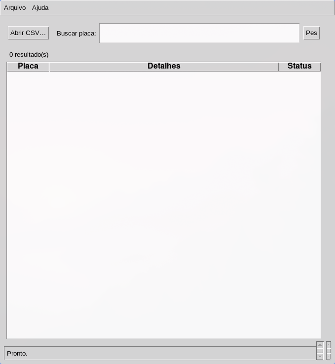
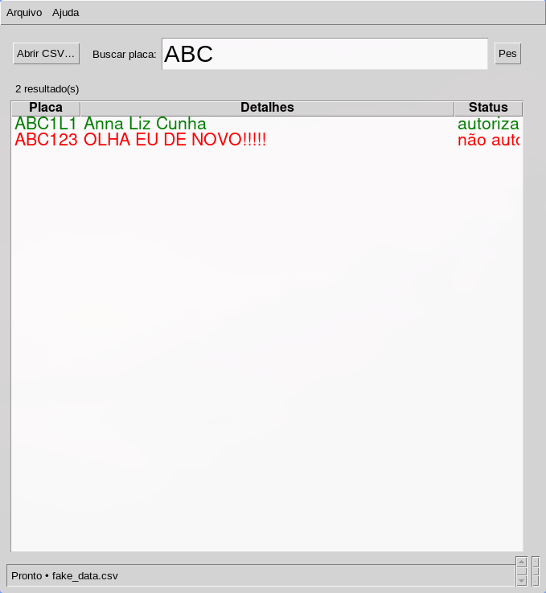

# Confere Placa

Aplicativo desktop para consulta e gerenciamento de placas de veículos autorizados. Dados persistidos em CSV — sem banco de dados.

## Screenshots

**Tela inicial (sem CSV carregado)**


**Busca com resultados — verde = autorizado, vermelho = não autorizado**


## Como rodar

```bash
# Versão monolítica (ativa)
python confere.py

# Versão refatorada MVC
python build_IA/main.py
```

Requer Python 3.5+ com `tkinter` disponível. Sem dependências externas.

## Uso

1. **Arquivo → Abrir CSV…** para carregar base de placas
2. Digite placa no campo de busca (Enter ou botão Pesquisar)
3. Duplo-clique no histórico para repetir busca anterior
4. **Adicionar / Editar / Excluir** via botões da barra superior

## Formato do CSV

Delimitado por `;`, sem cabeçalho:

```
PLACA;observações;status;timestamp_iso
```

Status válidos: `autorizado`, `não autorizado`, `para recepção`, `para entrega`, `autorizado_patio`

Placas excluídas ficam no CSV com status `excluido` (soft-delete).

Formato de placa aceito: `ABC1234` (antigo) ou `ABC1D23` (Mercosul).

## Gerar dados de teste

```bash
python fake_data.py
```

Gera `fake_data.csv` com 1000+ placas aleatórias.
